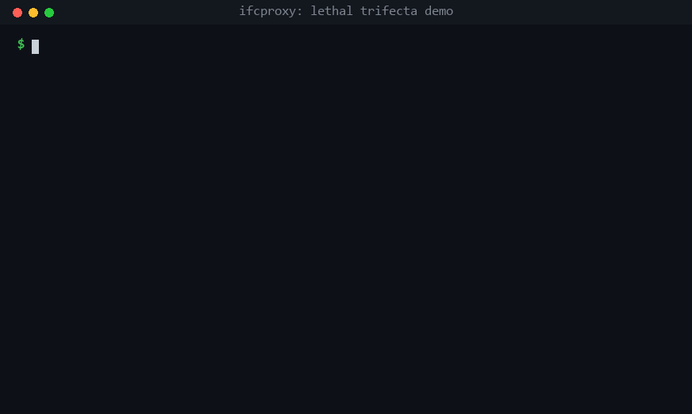

# ifcproxy

A stdio MCP proxy that blocks the **lethal trifecta** deterministically: private data, untrusted content and an external channel in one agent session.
- It sits between an MCP client and an MCP server.
- It labels the session from tool results (`untrusted`, `private`).
- It decides every `tools/call` with a YAML policy **before** the server sees it.
- No LLM classifiers, no heuristics: the same session and call always get the same decision.



The animation is the real output of `go run ./examples/trifecta-demo`: a real ifcproxy in front of the fake test server, with a scripted agent. A run with a live Claude Code agent and real servers is in [examples/agent-demo](examples/agent-demo/README.md).

```
MCP client ──stdin/stdout──▶ ifcproxy ──stdin/stdout──▶ MCP server
                               │  tools/call → Decide(session labels, tool) → allow | deny | ask
                               │  tool result → session labels |= produces(tool), then deliver
                               └─ everything else passes through byte-for-byte
```

Labels only ever accumulate within a session. Once a session has seen untrusted content *and* private data, external sinks are blocked for the rest of the session. That trade-off is deliberate (see [DESIGN](docs/DESIGN.md)).

## Quick start

**Prebuilt binaries** for Linux, macOS and Windows (amd64, arm64) are on the [releases page](https://github.com/nomaskscientist/ifcproxy/releases). Each archive includes the example policies, and `SHA256SUMS` lists the checksums.

**With Go 1.22+.** The only dependency is `gopkg.in/yaml.v3`.

```bash
go install github.com/nomaskscientist/ifcproxy/cmd/ifcproxy@latest
```

or, from a checkout:

```bash
go build -o bin/ifcproxy ./cmd/ifcproxy
```

```bash
bin/ifcproxy --policy examples/policy.yaml --check
```

```bash
bin/ifcproxy --policy examples/policy.yaml --audit audit.jsonl -- npx -y @modelcontextprotocol/server-filesystem ~/projects
```

The repository also has a fake server for trying the trifecta by hand: `go build -o bin/fakemcp ./test/fakemcp`, then run `bin/ifcproxy --policy examples/policy.yaml --ask-mode deny -- bin/fakemcp` and send `read_file`, `fetch_url`, `send_email` calls one at a time. The third one comes back as:

```json
{"jsonrpc":"2.0","id":3,"result":{"content":[{"type":"text","text":"ifcproxy blocked the call to tool \"send_email\": lethal trifecta: the session holds untrusted content and private data (decision: deny; session labels: untrusted|private; policy rule #0 at line 23). The tool was not executed."}],"isError":true,"_meta":{"ifcproxy/decision":{"action":"deny","code":"rule","rule":0,"labels":["untrusted","private"]}}}}
```

## Client configuration

Wrap the server command in any client that uses the usual `mcpServers` JSON (Claude Desktop, Claude Code, Cursor, …):

```json
{
  "mcpServers": {
    "filesystem": {
      "command": "/usr/local/bin/ifcproxy",
      "args": [
        "--policy", "/home/me/.config/ifcproxy/policy.yaml",
        "--audit", "/home/me/.local/state/ifcproxy/filesystem.jsonl",
        "--session-file", "/home/me/.local/state/ifcproxy/session",
        "--ask-mode", "deny",
        "--", "npx", "-y", "@modelcontextprotocol/server-filesystem", "/home/me/projects"
      ]
    }
  }
}
```

- **Give every server its own policy file.** Tools are matched by name only. Starting points for the official servers (filesystem, fetch, memory, everything) and a remote one (DeepWiki) are in [`examples/servers/`](examples/servers/).
- **Wrap every server with the same `--session-file`.** Otherwise each proxy has its own session, and a trifecta spread across servers goes undetected. Delete the file to start a new session.
- **GUI clients have no terminal for confirmations.** Use `--ask-mode deny` (or `allow`) explicitly with them. The default `tty` asks on the controlling terminal and denies when there is none.

## Policy

```yaml
version: 1
max_args_bytes: 65536            # larger arguments → deny

tools:                           # undeclared tools are ALWAYS denied
  fetch_url:  {produces: [untrusted], sink: external}   # a GET with a query string can exfiltrate
  read_file:  {produces: [private]}
  send_email: {sink: external}
  echo:       {}                 # declared, no labels, allowed

rules:                           # first match wins; `when` = all labels present
  - tool: sink:external          # a tool name, "*", or "sink:external"
    when: [untrusted, private]
    action: deny                 # allow | deny | ask
    reason: lethal trifecta
  - tool: send_email
    when: [private]
    action: ask
    reason: private data may leave by e-mail
```

- **Load-time checks.** The loader reports every problem as `file:line:col: path: message` and refuses to start on any of them. Among other things it rejects:
  - unknown fields;
  - tool names that differ only by case;
  - YAML anchors and tags;
  - **an external sink without a deny/ask rule for `[untrusted, private]`**: forgetting the rule is an error, not a silent hole.
- **Deny response.** A denied call returns an `isError` tool result explaining why, so the model and the user see the reason. The server never receives the call.

## Flags

| Flag | Default | Meaning |
|---|---|---|
| `--policy` | (required) | YAML policy |
| `--check` | | validate the policy and exit |
| `--ask-mode` | `tty` | `tty` (prompt on `/dev/tty` / console), `deny`, `allow` |
| `--ask-timeout` | `60s` | deny an unanswered prompt |
| `--audit` | `-` | JSONL audit log: path, `-` = stderr, `off` |
| `--log-args` | off | include tool arguments in the audit log |
| `--dry-run` | off | decide and log, but forward everything |
| `--session-file` | | share labels between proxies (one file per agent session) |
| `--session-id` | random | session id in audit records |
| `--max-message-bytes` | 16 MiB | per-message limit |
| `--max-pending` | 4096 | in-flight request limit |
| `--version` | | print the version and exit |

Audit record example:
```json
{"time":"2026-11-16T19:00:20.18+05:00","session":"demo","event":"call","id":3,"tool":"send_email","decision":"deny","policy_action":"deny","code":"rule","rule":0,"rule_line":23,"reason":"lethal trifecta: ...","labels":["untrusted","private"],"forwarded":false}
```

## What it does *not* guarantee

Read [docs/LIMITATIONS.md](docs/LIMITATIONS.md) before relying on this. The short version:

- **The policy is the boundary.** A tool that returns attacker-controlled text without `produces: [untrusted]`, or can send data out without `sink: external`, is a hole. ifcproxy trusts tool names. A malicious server can do anything inside any tool, or exfiltrate without being called.
- **Only `tools/call` results are labelled.**
  - Tool descriptions (`tools/list`), `resources/read`, `prompts/get`, `initialize` instructions and sampling requests pass through unlabelled.
  - So does anything the user pastes, or that other unproxied servers provide.
- **It cannot see the model.** Taint is per session, not per value. Expect over-blocking once both labels are present; there is no declassification.
- **Harm that needs no sink is not stopped** (deleting files, for example) unless you write per-tool rules for it.
- **Cross-server trifectas need `--session-file`.** Without it, each proxy guards only its own server.
- **stdio only.** ifcproxy does not speak Streamable HTTP itself. Remote servers work through a stdio bridge: `ifcproxy --policy p.yaml -- npx -y mcp-remote https://example.com/mcp` (tested with DeepWiki; details in [REAL_SERVERS](docs/REAL_SERVERS.md#remote-servers-through-mcp-remote)). The client is trusted: anything that starts the server without the proxy bypasses it.

## Development

```bash
make vet test race bench fuzz
```

- **Race tests** need cgo (a C compiler). On Windows without one, run `go test -race ./...` under WSL.
- **Attack scenarios:** [docs/ATTACKS.md](docs/ATTACKS.md).
- **Real servers and client:** [docs/REAL_SERVERS.md](docs/REAL_SERVERS.md). Tested with official servers (filesystem, fetch, memory, everything) and the official Inspector client, including MCP Tasks. Measured overhead: about 60 µs per call.
- **Benchmarks:** [docs/BENCH.md](docs/BENCH.md). `Decide`: about 15–30 ns/op, 0 allocations, p99 about 50 ns.
- **Design notes:** [docs/DESIGN.md](docs/DESIGN.md).

## License

Apache License 2.0 — see [LICENSE](LICENSE) and [NOTICE](NOTICE).
